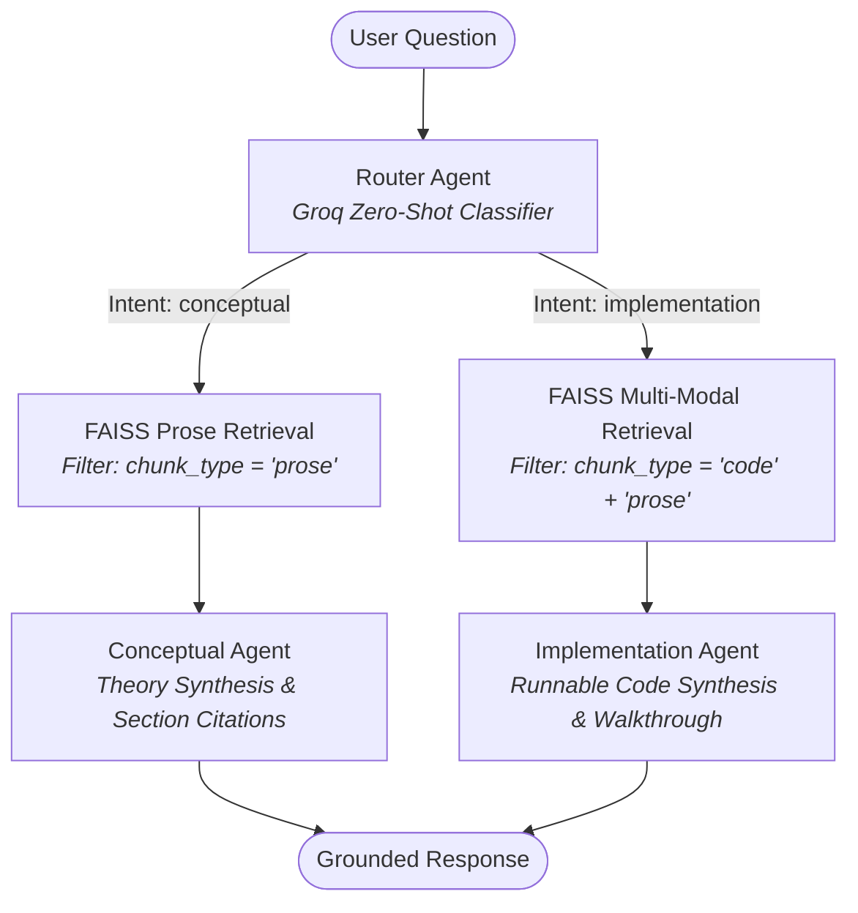

<div align="center">

# 🧠 Multi-Agent Doc Intelligence

**A production-ready Multi-Agent RAG pipeline engineered for parsing, indexing, and querying technical documentation with zero hallucinated code.**

[](https://python.org)
[](https://github.com/langchain-ai/langgraph)
[](https://groq.com)
[](https://github.com/facebookresearch/faiss)
[](https://github.com/astral-sh/ruff)
[](https://pytest.org)
[](LICENSE)

</div>

---

## 📌 Executive Summary

Traditional Retrieval-Augmented Generation (RAG) pipelines often struggle with technical documentation. Standard character or sentence splitters frequently sever code blocks mid-function, separate crucial markdown tables from their context, or retrieve code examples when the user asked for high-level theory.

**Multi-Agent Doc Intelligence** solves this using an AST-aware parser and a tri-agent stateful graph powered by **LangGraph** and **Groq**:
1. **Structural Markdown Chunking**: Ingestion parses markdown into an AST (`markdown-it-py`), preserving heading hierarchies and treating fenced code blocks as atomic chunks.
2. **Dynamic Query Routing**: A specialized **Router Agent** classifies user queries as either `conceptual` (theory, architecture) or `implementation` (syntax, runnable code).
3. **Specialized Downstream Agents**:
   - **Conceptual Agent**: Queries prose-only vectors to construct architectural explanations with exact section citations (`[Section: Overview > Core Architecture]`).
   - **Implementation Agent**: Prioritizes code vectors and surrounding prose to produce complete, executable snippets.

---

## 🏛 Architecture



### LangGraph State Machine

The pipeline state is maintained by `AgentState`:

```python
class AgentState(TypedDict):
    query: str
    intent: str
    retrieved_chunks: list[dict]
    response: str
    messages: Annotated[list[BaseMessage], add_messages]
```

- **Stateless Nodes, Stateful Graph**: All agent nodes are pure functions receiving `AgentState` and returning state deltas.
- **Dependency Injection**: Services such as `VectorStore` are injected via `functools.partial`, maintaining testability without global state.

---

## 📂 Repository Structure

```
multi-agent-doc-intelligence/
├── .github/
│   └── workflows/
│       └── ci.yml               # Automated CI (linting & testing matrix)
├── data/
│   ├── raw/                     # Source Markdown documentation (sample included)
│   │   └── sample_docs.md
│   └── index/                   # Auto-generated FAISS index and metadata
├── src/
│   ├── agents/
│   │   ├── router_agent.py      # Zero-shot query classifier
│   │   ├── conceptual_agent.py  # Theory & architecture generator
│   │   └── implementation_agent.py # Executable code generator
│   ├── ingestion/
│   │   ├── parser.py            # AST-aware Markdown parser
│   │   └── chunker.py           # Header- & code-block-preserving chunker
│   ├── pipeline/
│   │   ├── graph.py             # LangGraph StateGraph assembly
│   │   └── state.py             # Shared AgentState definition
│   ├── retrieval/
│   │   ├── embedder.py          # SentenceTransformers wrapper
│   │   └── vectorstore.py       # FAISS index builder & metadata retriever
│   └── config.py                # Environment configuration and paths
├── tests/
│   ├── test_agents.py           # Agent unit tests (fully mocked LLM)
│   ├── test_cli.py              # CLI argument parsing and error handling tests
│   ├── test_parser.py           # AST parser and chunker edge cases
│   ├── test_pipeline.py         # End-to-end LangGraph pipeline tests
│   └── test_retrieval.py        # VectorStore indexing and top-k filtering tests
├── main.py                      # Production CLI interface
├── pyproject.toml               # Modern build configuration & tool settings
├── requirements.txt             # Locked project dependencies
├── .env.example                 # Environment configuration template
└── LICENSE                      # MIT License
```

---

## 🚀 Quickstart

### 1. Prerequisites

- Python 3.10+ installed
- A free [Groq API Key](https://console.groq.com)

### 2. Setup Environment

```bash
# Clone the repository
git clone https://github.com/pratstick/multi-agent-doc-intelligence.git
cd multi-agent-doc-intelligence

# Create virtual environment
python -m venv .venv
# Activate virtual environment
source .venv/bin/activate       # macOS / Linux
.venv\Scripts\activate          # Windows PowerShell / CMD

# Install dependencies
pip install -r requirements.txt
```

### 3. Configure API Credentials

```bash
cp .env.example .env
```

Edit `.env` and set your Groq API key:
```ini
GROQ_API_KEY=gsk_your_actual_groq_api_key
```

### 4. Ingest Documentation

The repository comes preloaded with sample documentation (`data/raw/sample_docs.md`). Ingest it into your local FAISS index:

```bash
python main.py ingest
```

To ingest documentation from any custom folder:
```bash
python main.py ingest --dir /path/to/my/markdown/docs
```

### 5. Query the Pipeline

#### Ask a single conceptual question:
```bash
python main.py query -q "How does LangGraph manage state?"
```

#### Ask an implementation question with source citations:
```bash
python main.py query -q "Show me how to build and compile a StateGraph" --show-sources
```

#### Launch interactive query mode:
```bash
python main.py query
```

---

## 🖥 Example Output

```text
============================================================
  Routing Intent : IMPLEMENTATION
============================================================

[Retrieved Context]
  [1] (code) Building a Graph > Wiring the Graph (from: data/raw/sample_docs.md | L2 distance: 0.2814)
  [2] (prose) Building a Graph > Implementing Graph Nodes (from: data/raw/sample_docs.md | L2 distance: 0.3541)

[Answer]
To construct and compile a StateGraph in LangGraph, define your state schema, register your nodes, connect edges (including START and END), and compile:

```python
from langgraph.graph import StateGraph, START, END
from typing_extensions import TypedDict

class MyState(TypedDict):
    query: str
    response: str

def dummy_node(state: MyState) -> dict:
    return {"response": f"Processed: {state['query']}"}

# 1. Initialize StateGraph
builder = StateGraph(MyState)

# 2. Register nodes
builder.add_node("process", dummy_node)

# 3. Add edges
builder.add_edge(START, "process")
builder.add_edge("process", END)

# 4. Compile graph
graph = builder.compile()
```

### Explanation
- `StateGraph(MyState)` initializes the builder bound to your state schema.
- `builder.add_edge(START, "process")` sets the entry point.
- `builder.compile()` returns an executable `CompiledGraph` ready for `.invoke()` or `.stream()`.
============================================================
```

---

## ⚙️ Configuration Reference

All settings can be customized via `.env` or system environment variables:

| Variable | Default | Description |
|---|---|---|
| `GROQ_API_KEY` | *(required)* | Groq Cloud API authentication key |
| `GROQ_MODEL` | `llama3-8b-8192` | Model identifier on Groq (e.g. `llama3-70b-8192`) |
| `EMBEDDING_MODEL` | `sentence-transformers/all-MiniLM-L6-v2` | HuggingFace embedding model |
| `RETRIEVAL_TOP_K` | `5` | Number of chunks retrieved per search |
| `CHUNK_MAX_CHARS` | `1500` | Soft limit for prose chunk size before sentence-split |
| `CHUNK_OVERLAP_CHARS` | `150` | Overlap character count prepended to split chunks |

---

## 🧪 Testing & Code Quality

The repository includes a comprehensive test suite covering the parser, chunker, vectorstore, state graph, and CLI. All tests mock external network requests and run offline.

```bash
# Run test suite
pytest

# Run tests with coverage
pytest --cov=src --cov-report=term-missing

# Run code linter
ruff check .

# Check formatting
ruff format --check .
```

---

## 📄 License

This project is licensed under the [MIT License](LICENSE).
